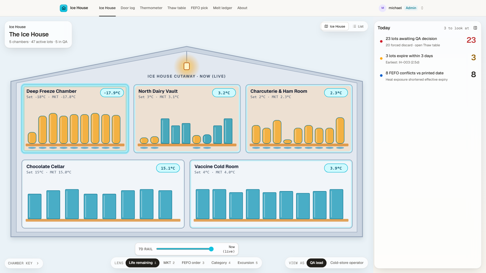

# Ice House

Log cold-room temperatures, detect excursions past the door-open grace window, compute pharmacopoeial Mean Kinetic Temperature (MKT) and Q10 consumed shelf life for every lot, and let QA release, quarantine, or discard with the arithmetic in front of them. Picking follows earliest effective expiry (FEFO), not the printed date.




## This repository

```text
apps/ice-house/   the app: React + Vite frontend, Rayfin data model (rayfin/), tests, demo walkthrough
shared/         shared package (@x10/shared): data store, sign-in runtime, UI kit, charts
tools/          deploy, seed, SQL and secrets-check scripts
```

Quick start (no Fabric tenant needed, runs in demo mode with sample data):

```bash
npm install
npm run dev
```

## The problem & rules

Peak season fills cold rooms with cheese, hams, chocolate, and vaccines. When a compressor trips overnight or a door is propped open, nobody can say how much life each lot has left, so either everything is binned or everything ships.

Ice House enforces five domain rules (`src/domain/config.ts`, `src/domain/thermal.ts`):
1. **Mean Kinetic Temperature (MKT):** time-weighted Arrhenius mean with `ΔH/R = 10,000 K` (`ΔH = 83.144 kJ/mol`, pharmacopoeial convention). A constant series returns itself; a spike exceeds the arithmetic mean.
2. **Consumed shelf life:** each interval adds `Δt × Q10^((T − Tref) / 10) / shelfLifeHours` to `consumedPct` using illustrative category Q10 defaults (dairy 3.0, meat 3.0, chocolate 2.0, bakery 2.5, pharma 2.0, produce 2.8).
3. **Excursions & hard food rules:** consecutive out-of-range readings longer than `GRACE_MIN` (10 min) form an excursion (brief door opens are ignored). Chilled TCS lots with more than `MAX_HOURS_ABOVE_5` (4 h) cumulative above 5 °C are forced to discard; frozen lots above −12 °C for 30+ minutes may not be re-frozen.
4. **Effective expiry & FEFO:** `effectiveExpiry = now + remainingLife` at the lot's mean temperature; `fefoOrder` picks earliest effective expiry first, placing `watch` lots last until QA releases them.
5. **QA decisions:** 100% consumed forces discard; 70–100% requires QA; only an admin (QA lead) can release a quarantined lot, writing an immutable `Assessment` record.

## What it looks like

**The Ice House** is a stone cutaway of an old ice house in SVG: five masonry chambers lined with frost proportional to their setpoint, straw-lined shelves, a hanging gable lantern, and ice blocks for each lot whose height equals remaining shelf life. Heat-exposed blocks round off and puddle below the shelf, excursions wash a warm tint down the chamber wall, and a 7-day time rail replays the compressor trip.

- **Lenses (keys 1–5):** Life remaining, MKT, FEFO order, Category, Excursion.
- **View as (key V):** QA lead or Cold-store operator.
- **Tools:** **Door log** (manual readings & logger feed), **Thermometer** (7-day trace, excursions & MKT), **Thaw table** (QA assessment & release/discard), **FEFO pick** (effective-expiry pick list), **Melt ledger** (QA audit trail), **About**.
- **Fallbacks:** Full accessible List view (`ViewToggle`), `?nowebgl` and `prefers-reduced-motion` support, and designed light & dark themes.

## Prerequisites

- Microsoft Fabric workspace on a capacity with the Fabric Apps workload enabled and Edit permission.
- Node.js 20+ for local development and deployment.

## Run locally

```bash
# At repo root
npm install

# Demo mode (in-memory store, deterministic seed, persona switcher)
cd apps/ice-house
npm run dev

# Connected to Fabric via Rayfin local dev
npm run dev:fabric
```

## Deploy

```bash
cd apps/ice-house
npx rayfin up --workspace-id <your-workspace-id>
```

## Seed

```bash
cd apps/ice-house
npm run seed:fabric -- --admin-email you@org.com
```

The first persona (`Morgan Ellis`, QA lead) is seeded as admin. In Fabric mode, pass `--admin-email` to grant QA lead rights to your account.

## How it works

| Entity | Purpose | Row security |
| --- | --- | --- |
| `Room` | Cold-store chambers & min/max/setpoint limits | Authenticated read; admin write in domain |
| `Lot` | Product lots, Q10, consumed %, status | Authenticated read; admin write in domain (except picker `qty` decrements) |
| `Reading` | Timestamped chamber temperatures | Authenticated read; `claims.sub.eq(item.recordedBy)` on create; immutable |
| `Assessment` | QA disposition with MKT, consumed %, hours >5 °C | Authenticated read; `claims.sub.eq(item.decidedBy)` on create; immutable |

## Known limits

- Rayfin's policy DSL enforces immutable `Reading` and `Assessment` creation scoped to `claims.sub`, while QA-lead-only release/quarantine/discard and picker `qty` checks are enforced in `src/domain/operations.ts`.
- Q10 defaults are illustrative category values; calibrate against product stability studies for production use.

## Later

- Direct Bluetooth / LoRaWAN logger webhook ingestion.
- Automated SMS/Teams excursion escalation when a chamber crosses `GRACE_MIN`.

## Gallery

**Title:** 12 Days of Fabric Apps: Day 3.5 – Ice House

**Blurb:** When a cold-room compressor trips overnight during peak season, teams need arithmetic instead of guesswork. Ice House renders five stone cold-store chambers where each lot is a block of ice as tall as its remaining shelf life, melting and puddling as heat exposure accumulates. Scrub the seven-day rail to replay excursions, inspect Mean Kinetic Temperature on the Thermometer, enforce mandatory discard rules on the Thaw table, and pick by effective expiry. Built with Microsoft Fabric Apps for AI at Work.

**Tags:** `Partner | 12 Days of Fabric Apps`

## License

MIT. See [LICENSE](LICENSE).
